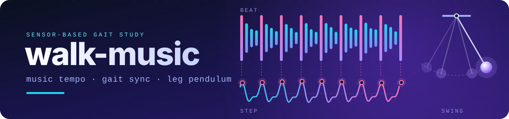
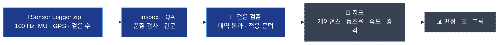

<div align="center">



# 내 플레이리스트가 걸음을 바꾼다

**노래의 템포가 우리의 발걸음을 끌어당길까?**<br>폰 센서로 걸음을 재는 보행 연구와, 그 뒤의 분석 파이프라인.

[English](README.md) · **한국어**

[](pyproject.toml) [](pyproject.toml) [](tests) [](pyproject.toml) [](docs/SPEC.md) [](docs)

[연구 소개](#연구-소개) · [분석 흐름](#분석-흐름) · [빠른 시작](#빠른-시작) · [문서](#문서) · [진행 상황](#진행-상황) · [개인정보](#개인정보) · [팀 작업 방법](#팀-작업-방법)

</div>

---

## 연구 소개

팀원 셋이 허리 파우치에 폰을 넣고 같은 길을 되풀이해서 걷는다. 처음엔 음악 없이, 그다음엔 템포가 다른 플레이리스트를 들으며 걷는다. 폰은 100 Hz 움직임과 GPS를 기록한다. 이 저장소는 그 기록을 숫자로 바꾼다: **걸음이 얼마나 잦은지, 박자에 얼마나 맞는지, 얼마나 빨리 걷는지, 발이 얼마나 세게 닿는지, 흔들리는 다리가 진자처럼 움직이는지.**

| &nbsp;&nbsp;&nbsp;&nbsp;&nbsp;&nbsp;&nbsp;&nbsp;&nbsp;&nbsp;&nbsp;&nbsp;&nbsp;&nbsp; | **실험 1** · 일상 보행 | **실험 2** · 템포 챌린지 | **실험 3** · 다리 진자 |
|---|---|---|---|
| **대상** | 걷는 사람 3명(A · B · C) | 같은 3명 | 같은 3명 |
| **과제** | 1인 15회, 평소 길 8분 이상: 무음 3 + 플레이리스트 4개 × 3. 지시 없음 | 평소 케이던스(PC)의 100–195% 박자에 걸음을 맞춰 40 m 코스를 걷거나 뛴다. 끝에 수직 점프 3회 | 다리를 힘 빼고 흔든다: 곧은 다리 3회, 무릎 약 90° 굽힌 다리 3회 |
| **폰** | 허리 파우치, 등 쪽, 가로 | 허리 파우치 | 정강이 밴드 |
| **날짜** | 2026-11-09 ~ 11-22 | 11-14 | 11-14 |
| **산출** | 곡별 케이던스, 박자 동조율, 속도, 보폭, 충격 | 동조율, 체공, 프루드 수, 달리기 다리 강성, 점프 높이 | 흔들림 주기와 진자 모델 비교, 진자 에너지 |

플레이리스트 4개는 각각 3곡이고, 보통 걷는 케이던스 언저리인 100–132 BPM에 걸쳐 있다.

### 가설

| | 내용 |
|---|---|
| **H1** | 곡 BPM이 평소 케이던스의 ±10% 안이면 지시하지 않아도 걸음이 박자 쪽으로 끌려간다. |
| **H1-2** | 박자에 맞추라고 하면 +20%까지 따라간다. |
| **H2** | 빠른 곡일수록 더 빨리, 더 큰 보폭으로, 더 세게 걷는다. 억지로 맞추면 걸음 변동성이 커진다. |
| **H3** | 걷기가 달리기로 바뀌는 지점이 프루드 수 약 0.5 근처다. |
| **H4** | 곧게 편 다리를 진자로 보고 예측한 케이던스는 실제 평소 케이던스보다 *느리다*. |

걷는 사람이 3명뿐이라 가설은 **사람마다** 판정한다. 3명 중 2명 이상에서 같으면 '지지'이고, H4만 3명 모두여야 한다.

> [!IMPORTANT]
> **가설 결과는 아직 없다. 일부러 그렇다.** 정의와 문턱은 데이터가 오기 전에 적어 두었다. 음악 회차의 결과는 코드와 파라미터를 git 태그(`analysis-freeze-g2`)로 고정하기 전에는 계산하지 않는다. 그때까지 개발은 무음 회차, 사전 점검 기록, 합성 신호로만 한다.

## 분석 흐름



*파랑 = 구현됨, 회색 = 예정(Phase 2 이후).*

- **품질 검사** — 한 회차마다 17개를 정해 두었고(파일 구성, 샘플링 끊김, 기록 길이, 서 있기, 단위, GPS 거리 대 지도 거리, zip ↔ 기록지 연결 등) 15개가 구현돼 있다. 판단 관문은 G1–G3 세 번이다.
- **걸음 검출** — 위상 왜곡 없는 대역 통과(0.8–5 Hz), 적응 문턱, 포물선 보간으로 봉우리 시각을 정한다. 기록 앞뒤의 서 있기도 찾아서 분석에서 뺀다.
- **폰에 대해 가정하지 않는다** — 단위, 중력 처리, 부호는 데이터로 판별하고, 수직 방향은 중력 벡터에서 얻는다. 폰을 세로로 넣든 가로로 넣든 결과가 같다.
- **정답을 아는 합성 기록** — 걸음, 서 있기, 만지작거림, 끊김, 방향을 넣은 Sensor Logger zip을 만들어서, 검출기를 정답과 비교해 시험한다.

## 빠른 시작

```bash
git clone https://github.com/joon56/my-ultimate-playlist.git
cd my-ultimate-playlist

python -m venv .venv
source .venv/bin/activate          # Windows: .venv\Scripts\activate
pip install -e ".[dev]"

pytest                             # 명세의 예제 수치 + 합성 신호 테스트
python -m walkmusic qa --gate G1 --synthetic     # 합성 데모 회차로 품질 관문 해 보기
```

> [!TIP]
> 실제 기록이 없어도 된다. 테스트와 데모가 합성 회차를 만들어 쓰고, 비공개 사전 점검 파일이 필요한 테스트는 `data/raw/`가 비어 있으면 알아서 건너뛴다.

### 명령

| 명령 | 하는 일 |
|---|---|
| `python -m walkmusic inspect <zip>` | 기록 하나의 파일 구성, 시각, 샘플링을 보여 준다(좌표는 출력하지 않는다) |
| `python -m walkmusic qa <zip>` · `qa --all` | 기록 하나 또는 `data/manifest.csv`의 모든 회차를 품질 검사한다 |
| `python -m walkmusic qa --links` | 기록 시작 시각으로 zip과 기록지 줄을 맞춘 연결 제안을 낸다 |
| `python -m walkmusic qa --gate G1 [--synthetic]` | 사람별 관문 표. `--synthetic`은 합성 데모 자료로 돌린다 |
| *(Phase 2)* `process` · `stats` · `figures` · `freeze` · `all` | 지표, 판정, 그림, 데이터 동결. 명령 한 줄로 전부 다시 만든다 |

## 폴더

```text
.
├─ src/walkmusic/        분석 패키지: 읽기, QA, 걸음 검출, 단위 판별, 지표, 합성 데이터
├─ tests/                pytest: 명세 예제 수치, 합성 신호 사례, QA 사례
├─ config/params.toml    모든 문턱과 파라미터. [확정]/[초안]과 결정 번호가 붙어 있다
├─ data/                 CSV 템플릿과 설명(원자료와 좌표는 git 제외)
├─ docs/                 명세, 프로토콜, QA 체크리스트, 결정 기록
├─ tools/assign.py       회차 배정표 재현 스크립트
├─ results/              만들어진 결과(다시 만들 수 있는 것은 git 제외)
├─ CLAUDE.md             이 프로젝트에 쓰는 Claude Code가 매 세션 읽는 규칙
└─ START_PROMPT.md       Claude Code에게 처음 붙여 넣는 프롬프트 모음
```

## 문서

| 문서 | 내용 |
|---|---|
| [`docs/SPEC.md`](docs/SPEC.md) | 분석 명세: 정의, 처리 순서, 출력, 테스트 수치 |
| [`docs/PROTOCOL.md`](docs/PROTOCOL.md) | 세 실험의 현장 절차 |
| [`docs/QA_CHECKLIST.md`](docs/QA_CHECKLIST.md) | 품질 검사 Q01–Q17, 관문 G1–G3 기준 |
| [`docs/DECISIONS.md`](docs/DECISIONS.md) | 결정 기록: 모든 기본값, 누가 승인했는지, 이후의 모든 변경 |
| [`docs/DATA_FACTS.md`](docs/DATA_FACTS.md) | 실제 파일에서 확인한 사실(단위, 시계, 샘플링, 특이점) |
| [`docs/HANDCALC.md`](docs/HANDCALC.md) | 테스트 수치와 같은 손계산 노트 |
| [`docs/CHECKLIST.md`](docs/CHECKLIST.md) | 열린 할 일 |
| [`data/README.md`](data/README.md) | CSV마다 열 설명 |

## 분석을 정직하게 지키는 방법

- **데이터 전에 고정한다.** [확정] 표시는 연구계획에서 온 값이라 코드가 바꾸지 않는다. [초안] 기본값에는 결정 번호가 있고, 실제 데이터를 본 뒤에는 변경 기록을 남겨야만 바꾸며 바꾸기 전 결과도 함께 보고한다.
- **조용히 고치지 않고 결정 기록에 적는다.** 코딩하다 명세가 틀려 보이면 `docs/DECISIONS.md`에 먼저 적는다.
- **분석 고정.** 음악 회차의 가설 결과는 고정 태그가 생긴 뒤에만 계산한다.
- **실행되는 명세.** 명세의 예제 수치와 보고서의 손계산이 그대로 테스트다. 코드와 손계산이 같아야 통과한다.
- **다시 만들 수 있게.** 목표는 기록에서 모든 표·그림까지 명령 한 줄, 난수 시드 고정이다.

## 진행 상황

| Phase | 시기 | 내용 | 상태 |
|:-:|---|---|:-:|
| 0 | 11/7–11/8 | 시범 기록에서 데이터 사실 확인 | ✅ |
| 1 | ~11/12 · 관문 G1 | 뼈대, 불러오기, QA, 걸음 검출 초안, 합성 데이터 생성기 | ✅ |
| 2 | ~11/18 · 관문 G2 | 실험 1 지표, 평소 케이던스, 판정, 첫 그림 | 🚧 |
| 3 | 11/14 데이터 → 11/22 | 실험 2·3: 템포 단계, 점프, 달리기 다리 강성, 곧은·굽힌 무릎 진자, 측정 검증, 처방 범위 | ⏳ |
| 4 | ~11/24 · 관문 G3 | 전체 표·그림, 데이터 표 v1.0 동결 | ⏳ |
| 5 | 11/24 이후(요청 시) | 같은 파이썬 코드를 쓰는 웹 데모 | 💤 |

✅ 끝 · 🚧 다음 · ⏳ 예정 · 💤 선택. 실험 1 걷기는 진행 중이다(11/9–11/22). 자세한 완료 기준은 [`docs/SPEC.md` §12](docs/SPEC.md).

## 개인정보

> [!WARNING]
> 이 저장소는 **공개**다(DECISIONS D-64). 위치 기록에는 평소 다니는 길이 그대로 들어 있으므로 원자료는 절대 올리지 않는다.

- 원자료(`data/raw/`), 풀어 쓴 파일(`data/interim/`), 경로 좌표(`data/private/`), 영상은 `.gitignore`로 제외했고 저장소 이력에도 없다.
- 좌표는 거리·속도·시각 계산에만 쓴다. 결과와 로그에는 위도·경도를 남기지 않으며, 품질 검사 Q15가 결과에 좌표가 새지 않았는지 훑는다.
- 기기 이름과 ID는 기록을 읽는 순간 버린다.
- 사람은 A, B, C로만 나온다. 보강 참가자(친구)가 있다면 동의 범위 안에서 N1–N4로만 다룬다.

## 팀 작업 방법

<details>
<summary>걷는 사람 · Claude Code 작업 순서 (펼치기)</summary>

<br>

1. 걷는 사람은 zip을 내보낸 이름 그대로 `data/raw/<사람>/`에 두고, 올린 뒤에는 읽기 전용으로 잠근다. macOS·Linux는 `chmod -R a-w data/raw`, Windows는 폴더 속성에서 읽기 전용으로 바꾼다. `data/raw/`의 원본은 고치거나 옮기거나 지우지 않는다.
2. 이 폴더에서 Claude Code를 연다. `CLAUDE.md`(매 세션 읽는 규칙)는 자동으로 불러와지고, 새 작업을 시작하는 프롬프트는 `START_PROMPT.md`에 있다.
3. Claude Code가 계획을 보여 주면 읽고 승인한다. 각 Phase는 계획 승인 → 구현 → 보고 순서(CLAUDE.md)로 간다.
4. 사람이 할 일과 답해야 할 질문은 [`docs/CHECKLIST.md`](docs/CHECKLIST.md)에 있다. 답은 번호로 준다(예: "K-60 안 넣음").

</details>

---

<div align="center">

<sub>기록은 <a href="https://www.tszheichoi.com/sensorlogger">Sensor Logger</a> 앱으로 한다. 연세대학교 Healthcare Biomechanics 팀 프로젝트. Claude Code와 함께 개발한다.</sub>

</div>
