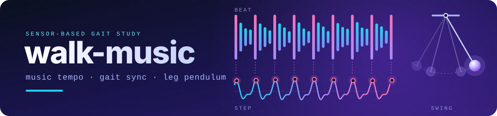
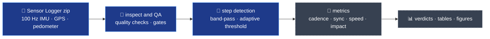

<div align="center">



# My Playlist Changes My Walk

**Does the tempo of a song pull our footsteps along?**<br>A sensor-based gait study — and the open analysis pipeline behind it.

**English** · [한국어](README.ko.md)

[](pyproject.toml) [](pyproject.toml) [](tests) [](pyproject.toml) [](docs/SPEC.md) [](docs)

[The study](#the-study) · [Pipeline](#pipeline) · [Quick start](#quick-start) · [Documentation](#documentation) · [Status](#status) · [Privacy](#privacy)

</div>

---

## The study

Three teammates carry a phone in a waist pouch and walk the same route again and again — first in silence, then to playlists of different tempi. The phone logs 100 Hz motion and GPS. This repository turns those recordings into numbers: **how often we step, how tightly steps lock onto the beat, how fast we go, how hard the heel lands, and how a swinging leg behaves like a pendulum.**

|  | **Experiment 1** · Everyday walking | **Experiment 2** · Tempo challenge | **Experiment 3** · Leg pendulum |
|---|---|---|---|
| **Who** | 3 walkers (A · B · C) | same 3 | same 3 |
| **Task** | 15 walks each on a usual route, 8+ min: 3 silent + 4 playlists × 3. No instructions | Step to a beat at 100–195 % of one's preferred cadence (PC) over a 40 m course — walking or running — then 3 vertical jumps | Swing the leg freely: straight × 3, knee bent ≈ 90° × 3 |
| **Phone** | waist pouch, back, landscape | waist pouch | band on the shank |
| **When** | Nov 9–22, 2026 | Nov 14 | Nov 14 |
| **Produces** | per-song cadence, beat-sync rate, speed, step length, impact | sync rate, flight time, Froude number, running leg stiffness, jump height | swing period vs. pendulum model, pendulum energy |

The four playlists hold three songs each and span roughly 100–132 BPM, around a typical walking cadence.

### Hypotheses

| | Claim |
|---|---|
| **H1** | When a song's BPM is within ±10 % of one's preferred cadence, steps drift toward the beat without being told to. |
| **H1-2** | When asked to match the beat, people follow it up to +20 %. |
| **H2** | Faster songs bring faster walking, longer steps and harder impact; forcing the match raises step-to-step variability. |
| **H3** | Walking turns into running near a Froude number of 0.5. |
| **H4** | A straight leg swung as a pendulum predicts a cadence *below* the real preferred cadence. |

With only three walkers, each hypothesis is judged **person by person**: supported when at least two of three agree (H4 needs all three).

> [!IMPORTANT]
> **There are no hypothesis results yet — on purpose.** Definitions and thresholds were written down before the data came in. Results for the music walks are not computed until the code and parameters are frozen under a git tag (`analysis-freeze-g2`). Until then, development uses silent walks, pre-check recordings and synthetic signals only.

## Pipeline



*Blue = implemented, grey = planned (Phase 2 and later).*

- **Quality checks** — 17 specified per walk (file set, sampling gaps, duration, standing windows, units, GPS vs. map distance, zip ↔ logbook link, …), 15 implemented, plus three review gates (G1–G3).
- **Step detection** — zero-phase band-pass (0.8–5 Hz), adaptive threshold, parabolic peak interpolation; standing phases at the start and end are found and trimmed.
- **Nothing assumed about the phone** — units, gravity handling and sign conventions are decided from the data, and the vertical axis comes from the gravity vector, so portrait or landscape carrying makes no difference.
- **Synthetic recordings with known truth** — a generator produces Sensor Logger zips (steps, standing phases, fidgeting, gaps, orientations) so detectors are tested against the ground truth.

## Quick start

```bash
git clone https://github.com/joon56/my-ultimate-playlist.git
cd my-ultimate-playlist

python -m venv .venv
source .venv/bin/activate          # Windows: .venv\Scripts\activate
pip install -e ".[dev]"

pytest                             # worked examples from the spec + synthetic-signal tests
python -m walkmusic qa --gate G1 --synthetic     # try the quality gate on generated demo walks
```

> [!TIP]
> No recordings are needed. The tests and the demo generate synthetic walks; tests that need the private pilot recordings skip themselves when `data/raw/` is empty.

### Commands

| Command | What it does |
|---|---|
| `python -m walkmusic inspect <zip>` | File structure, timing and sampling of one recording (never prints coordinates) |
| `python -m walkmusic qa <zip>` · `qa --all` | Quality checks for one recording or every walk in `data/manifest.csv` |
| `python -m walkmusic qa --links` | Propose which zip belongs to which logbook row, matched by start time |
| `python -m walkmusic qa --gate G1 [--synthetic]` | Gate table per person; `--synthetic` runs on generated demo data |
| *(Phase 2)* `process` · `stats` · `figures` · `freeze` · `all` | Metrics, verdicts, figures, data freeze — one command to rebuild everything |

## Repository layout

```text
.
├─ src/walkmusic/        analysis package: reading, QA, step detection, units, metrics, synthetic data
├─ tests/                pytest suite: spec worked examples, synthetic-signal cases, QA cases
├─ config/params.toml    every threshold and parameter, each tagged [confirmed] / [draft] with a decision ID
├─ data/                 CSV templates and column docs (raw recordings and coordinates are git-ignored)
├─ docs/                 specification, protocol, QA checklist, decision log (Korean)
├─ tools/assign.py       reproducible walk-order assignment
├─ results/              generated outputs (re-creatable ones are git-ignored)
├─ CLAUDE.md             standing rules for the Claude Code assistant used on this project
└─ START_PROMPT.md       prompts used to brief that assistant
```

## Documentation

> [!NOTE]
> The working language of the team is Korean, so the documents below are written in Korean. Section numbers, decision IDs (`D-01` …) and parameter names are stable, so they are easy to follow from this page.

| Document | What it holds |
|---|---|
| [`docs/SPEC.md`](docs/SPEC.md) | Analysis specification: definitions, processing order, outputs, test numbers |
| [`docs/PROTOCOL.md`](docs/PROTOCOL.md) | Field protocol for the three experiments |
| [`docs/QA_CHECKLIST.md`](docs/QA_CHECKLIST.md) | Quality checks Q01–Q17 and gate criteria G1–G3 |
| [`docs/DECISIONS.md`](docs/DECISIONS.md) | Decision log: every default, who approved it, and every later change |
| [`docs/DATA_FACTS.md`](docs/DATA_FACTS.md) | Facts verified on real recordings (units, clocks, sampling, quirks) |
| [`docs/HANDCALC.md`](docs/HANDCALC.md) | Hand calculations that match the test numbers |
| [`docs/CHECKLIST.md`](docs/CHECKLIST.md) | Open to-dos |
| [`data/README.md`](data/README.md) | Column reference for every CSV |

## How the analysis stays honest

- **Fixed before the data.** Items marked *confirmed* come from the study plan and are never changed by code. *Draft* defaults carry a decision ID, and after real data has been seen they change only through a logged entry that also reports the results from before the change.
- **A decision log, not silent edits.** If the spec looks wrong while coding, the doubt goes into `docs/DECISIONS.md` first.
- **An analysis freeze.** Hypothesis results for the music walks are computed only after the freeze tag exists.
- **Executable spec.** The worked examples in the spec — and the hand calculations used in the report — are tests; code and hand calculation must agree.
- **Rebuildable.** The goal is one command from recordings to every table and figure, with fixed random seeds.

## Status

| Phase | When | Scope | Status |
|:-:|---|---|:-:|
| 0 | Nov 7–8 | Verify data facts on pilot recordings | ✅ |
| 1 | by Nov 12 · gate G1 | Package skeleton, loading, QA, step-detection draft, synthetic-data generator | ✅ |
| 2 | by Nov 18 · gate G2 | Experiment 1 metrics, preferred cadence, verdicts, first figures | 🚧 |
| 3 | data Nov 14 → Nov 22 | Experiments 2–3: tempo stages, jumps, running-leg stiffness, straight and bent-knee pendulum, measurement validation, prescription range | ⏳ |
| 4 | by Nov 24 · gate G3 | Full tables and figures; data tables frozen as v1.0 | ⏳ |
| 5 | after Nov 24, on request | Web demo reusing the same Python code | 💤 |

✅ done · 🚧 next · ⏳ planned · 💤 optional. Data collection for Experiment 1 is under way (Nov 9–22). Details and completion criteria: [`docs/SPEC.md` §12](docs/SPEC.md).

## Privacy

> [!WARNING]
> This repository is **public**. A location track follows everyday routes, so raw data never goes into it.

- Raw recordings (`data/raw/`), unpacked files (`data/interim/`), route coordinates (`data/private/`) and videos are git-ignored and are not in the repository history.
- Coordinates are used only to compute distance, speed and time. Results and logs never contain latitude or longitude, and quality check Q15 scans the outputs for leaks.
- Device names and IDs are dropped the moment a recording is read.
- People appear only as A, B and C. Optional extra volunteers would be handled only as N1–N4, within their consent.

---

<div align="center">

<sub>Recordings are made with the <a href="https://www.tszheichoi.com/sensorlogger">Sensor Logger</a> app. A Healthcare Biomechanics team project at Yonsei University. Developed together with the Claude Code assistant.</sub>

</div>
